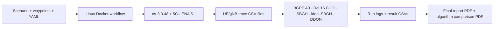

<!-- logo:begin -->
<div align="center">
  
</div>
<!-- logo:end -->

# HandoverLab 5G

An integrated Linux workflow for simulating cellular mobility with **ns-3 and 5G-LENA**, then evaluating five handover result paths against the same saved UE/gNB traces.

<!-- badges:begin -->
<div align="center">
  <a href="https://portal.aiori.in/aiori-3/hackathon-guideline/" target="_blank" rel="noopener"></a>
  <a href="https://portal.aiori.in/aiori-3/hackathon-guideline/" target="_blank" rel="noopener"></a>
  <a href="https://portal.aiori.in/aiori-3/hackathon-guideline/" target="_blank" rel="noopener"></a>
  <br>
  
  
  <a href="https://youtu.be/EAUCb3XLsi8" target="_blank" rel="noopener"></a>
  <a href="https://youtu.be/NRT5OSP-eOY" target="_blank" rel="noopener"></a>
</div>
<!-- badges:end -->

**Jump to:** [Demo videos](#project-videos) · [Team](#team-gridlock) · [Judge fast path](#judge-fast-path) · [Problem and solution](#problem-and-solution) · [Features](#what-the-workflow-automates) · [Algorithms](#handover-methods) · [Quick start](#quick-start-in-linux-docker) · [Results](#example-results) · [Repository map](#repository-map) · [Limitations](#honest-limits)

## Project videos

<!-- demo-video:begin -->
<div align="center">

### Watch the project

</div>

| Recording | Online video | Local copy |
|---|---|---|
| Team introduction | [Watch on YouTube](https://youtu.be/EAUCb3XLsi8) | [A3-PS016-TC106_Team_Gridlock_AIORI-3.mp4](A3-PS016-TC106_Team_Gridlock_AIORI-3.mp4) |
| Final project demonstration | [Watch on YouTube](https://youtu.be/NRT5OSP-eOY) | [Final_Project_Demo_A3-PS016-TC106_Team_Gridlock.mp4](Final_Project_Demo_A3-PS016-TC106_Team_Gridlock.mp4) |

<!-- demo-video:end -->

## Team GRIDLOCK

| Field | Details |
|---|---|
| **Team name** | GRIDLOCK |
| **Team code** | `A3-PS016-TC106` |
| **Hackathon** | AIORI-3 Hackathon 2026 |
| **Problem statement** | PS-016 — Simulation-Based Handover Decision Evaluation for High-Mobility Users |
| **Category** | Track 4 — 6G & Future Networks |
| **Project name** | HandoverLab 5G |

| Team member | Role |
|---|---|
| Nabhonil Bhattacharjee | Team member |
| Arka Manna | Team member |
| Dr. Raja Karmakar | Faculty mentor |

## Judge fast path

- [**Final project demonstration**](Final_Project_Demo_A3-PS016-TC106_Team_Gridlock.mp4) — local video recording.
- [**Team introduction**](A3-PS016-TC106_Team_Gridlock_AIORI-3.mp4) — local introduction video.
- [**Project presentation PDF**](A3-PS016-TC106_Team_Gridlock_AIORI-3.pdf) — proposed structure and hackathon presentation.
- [**Latest saved run report**](src/handover-simulator/traces/2026-10-29_22-09-42/Final_Report.pdf) — configuration, run status and result charts.
- [**Algorithm comparison PDF**](src/handover-simulator/traces/2026-10-29_22-09-42/Algorithm_Performance.pdf) — per-run comparison of the five methods.
- [**Complete usage guide**](src/documentation/usage-guide.md) — configuration examples, input formats, output files and interpretation.
- [**Video narration and screen directions**](src/documentation/video-script.md).

The team README documented **steps 1–10 as completed** and was last updated on 30 October 2026. The source tree has since been organized under `src/` and includes additional documentation and run artifacts.

## Problem and solution

High-mobility users move between cells as radio conditions change. Researchers need to compare handover strategies under repeatable network conditions and inspect what happened, from signal and traffic traces to policy outputs. Setting up ns-3/5G-LENA simulations, collecting files, and calling different policies can require substantial per-experiment integration work.

**HandoverLab 5G connects those stages:** configure a cellular scenario and UE mobility, generate traces in ns-3/5G-LENA, replay the same trace set through five handover result paths, then produce logs, CSVs and PDF analysis. The work in this repository integrates and extends an existing handover-simulation codebase; ns-3, 5G-LENA and the underlying published algorithms are not claimed as original creations by Team GRIDLOCK.



## What the workflow automates

- Defines geometry, frequency bands, base stations and UE movement through scenario and waypoint text files.
- Accepts run settings through CLI arguments or YAML, including seed, duration, sample interval, traffic and handover parameters.
- Builds and runs the ns-3/5G-LENA simulation in Linux, generating trace CSVs for each UE/gNB pair.
- Reuses saved traces to evaluate algorithms without repeating the network simulation.
- Runs five policy result paths on a shared input trace set.
- Shows DDQN episode progress and supports configurable maximum episodes and training time.
- Writes Python console output and ns-3 subprocess output to session and per-run logs.
- Snapshots effective settings and selected input files into the run folder.
- Produces per-algorithm result files, comparison CSV, completion status JSON, DDQN training history, a run report PDF and an algorithm comparison PDF.
- Uses Docker bind mounts so source edits and generated trace/report files are visible from the Windows project directory.

## Handover methods

| Method | Role in this simulator |
|---|---|
| **3GPP Rel.15 A3** | Signal-event baseline using configurable hysteresis, A3 offset and time-to-trigger. |
| **3GPP Rel.16 CHO** | Conditional handover path with candidate preparation and conditional execution. |
| **SBGH** | Score-based greedy selection using signal and cell/bandwidth information. |
| **ideal-SBGH** | SBGH comparison variant without the configured handover delay. |
| **DDQN** | Learned serving-cell action policy using simulated state and reward. |

See [algorithm descriptions](src/docs/algorithms.md) and the [source map](src/documentation/source-code.md) for implementation details. The five result paths are compared within a simulation run; they do not establish statistical superiority from one seed.

## Quick start in Linux Docker

The project targets Ubuntu 24.04 with ns-3 3.48 and 5G-LENA 5.1. The Docker Compose and Dockerfile are in `src/`.

From PowerShell at the `MAIN` directory:

```powershell
Set-Location .\src
docker compose run --rm -it simulator
```

Or build/start the Compose service and open its shell:

```powershell
Set-Location .\src
docker compose up -d --build
docker compose exec simulator bash
```

Inside the Linux container:

```bash
cd /app/handover-simulator/src
python3 main.py --help
python3 -u main.py --config /app/documentation/examples/quick.yaml \
  --ddqnEpisodes 5 --ddqnTimeLimit 120
```

The full default simulation can use substantial CPU and memory. Start with the short example to confirm configuration and output paths. Five DDQN episodes are a quick-run default, not evidence of training convergence. See [build and execution](src/documentation/build-execution.md) and [troubleshooting](src/documentation/troubleshooting.md).

### Use the prebuilt image

```powershell
docker pull razorsharp571/5g-handover-sim:latest
```

The project image is configured by the Compose file. Run Compose from `MAIN/src` so its bind mounts persist traces on Windows. A bare `docker run` without mounts keeps generated results only in the container filesystem.

### Code and image changes

Python and C++ source, scenario, waypoint and trace paths are mounted from `MAIN/src`; those code edits do not require rebuilding the Docker image. The run workflow builds the ns-3 target before simulation, so C++ changes are compiled during the next run. Recreate a container after changing Compose mounts. Rebuild the image after changing the Dockerfile or installed system dependencies:

```powershell
docker compose build
```

### Where the output appears

Compose mounts `/app/handover-simulator/traces/` to `MAIN/src/handover-simulator/traces/`. Each run creates a timestamped folder containing `Final_Report.pdf`, `Algorithm_Performance.pdf`, `algorithm_comparison.csv`, `run_status.json`, `run.log`, input snapshots and detailed algorithm results.

## Example results

The latest linked saved run used five UEs, eight gNBs, a 10-second simulation and base seed 1234. It produced **40 of 40 expected trace CSVs**, result CSVs for all five methods, and both PDFs. Its run status is `COMPLETE` with no recorded algorithm errors.

In that single run, the comparison CSV reports mean aggregate throughput of approximately **1,596 Mbps** for A3 and Rel.16 CHO, **1,879 Mbps** for SBGH and ideal-SBGH, and **1,175 Mbps** for DDQN. These are descriptive outputs from one scenario and seed, not multi-seed or statistical conclusions. The DDQN training record stopped at its configured time limit after four recorded/partial episodes; a complete pipeline status means output generation completed, not that all requested training episodes finished.

## Project resources

- [Team GRIDLOCK GitHub repository](https://github.com/aiori-hackathon/A3-PS016-TC106)
- [Project presentation PDF](A3-PS016-TC106_Team_Gridlock_AIORI-3.pdf)
- [Team introduction on YouTube](https://youtu.be/EAUCb3XLsi8)
- [Final project demonstration on YouTube](https://youtu.be/NRT5OSP-eOY)
- [Final report for the latest saved run](src/handover-simulator/traces/2026-10-29_22-09-42/Final_Report.pdf)
- [Algorithm performance report](src/handover-simulator/traces/2026-10-29_22-09-42/Algorithm_Performance.pdf)
- [Project final technical report](src/FINAL_REPORT.md)
- [RFC-2330 security and privacy notes](src/documentation/security-and-rfc2330.md)

## Repository map

| Path | Contents |
|---|---|
| `src/network-simulator/` | C++ ns-3/5G-LENA network simulation source. |
| `src/handover-simulator/src/` | Python orchestration, trace loading, algorithms, logging and report generation. |
| `src/handover-simulator/scenario/` | Default cellular layout and frequency/band configuration. |
| `src/handover-simulator/waypoints/` | UE waypoint mobility inputs. |
| `src/documentation/examples/` | Sample YAML, scenario and waypoint configuration files. |
| `src/docs/` | Algorithm, architecture, configuration and scenario-format notes. |
| `src/documentation/` | Installation, usage, testing, security and project guides. |
| `assets/` | HandoverLab 5G README logo. |
| `A3-PS016-TC106_Team_Gridlock_AIORI-3.pdf` | Team presentation. |
| `*_A3-PS016-TC106_Team_Gridlock*.mp4` | Local video recordings. |

## Documentation

- [Usage guide and examples](src/documentation/usage-guide.md)
- [Quick start](src/documentation/quick-start.md)
- [Installation](src/documentation/installation.md)
- [Architecture](src/documentation/architecture.md)
- [Configuration and inputs](src/documentation/configuration-inputs.md)
- [Build and execution](src/documentation/build-execution.md)
- [Testing and validation](src/documentation/testing.md)
- [Troubleshooting](src/documentation/troubleshooting.md)
- [Video script](src/documentation/video-script.md)
- [Project final report](src/FINAL_REPORT.md)
- [RFC-2330 security and privacy](src/documentation/security-and-rfc2330.md)

## Honest limits

- Saved comparisons describe the selected simulation run; the project does not yet provide a multi-seed aggregator or confidence-interval analysis.
- Handover counts, packet loss, throughput and latency-related CSV values are available. The project does not provide an independently validated standardized reliability score or standalone measured interruption-duration metric.
- A short DDQN run checks workflow execution; it does not establish policy convergence or generalization.
- This is an offline simulator. The algorithms do not provide live-network measurement authorization, DoS detection, payload encryption, anonymization, or retention controls.
- UE position, radio, timing and traffic measurements can be sensitive even when packet payloads are not recorded. Protect trace folders before sharing.

---

<div align="center">
  <sub>HandoverLab 5G · Team GRIDLOCK · A3-PS016-TC106 · AIORI-3 2026 · PS-016</sub><br>
  <sub><a href="Final_Project_Demo_A3-PS016-TC106_Team_Gridlock.mp4">Project demo</a> · <a href="A3-PS016-TC106_Team_Gridlock_AIORI-3.pdf">Presentation</a> · <a href="src/documentation/usage-guide.md">Usage</a> · <a href="src/documentation/security-and-rfc2330.md">Security and privacy</a> · <a href="#handoverlab-5g">Back to top</a></sub>
</div>
